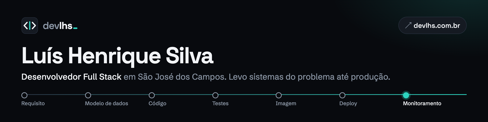

<a href="https://devlhs.com.br">
  <picture>
    <source media="(prefers-color-scheme: dark)" srcset="assets/banner-escuro.png">
    <source media="(prefers-color-scheme: light)" srcset="assets/banner-claro.png">
    
  </picture>
</a>

  
  
  
  

### Sobre mim

Desenvolvo sistemas web de ponta a ponta: do requisito levantado com quem vai usar até o deploy com backup, rollback e monitoramento. Hoje trabalho com **Python, Zope e PostgreSQL na Nube**, e fora dela construo e mantenho sozinho os projetos abaixo.

- **Desenvolvedor Full Stack Júnior na Nube** desde jun/2025 (estagiário de jan/2024 a jun/2025).
- **Responsável de TI voluntário do [Grupo Suçuarana](https://sussuarana.org.br)** desde mai/2025: fiz o site e o painel admin e mantenho a infraestrutura (Docker em VPS, Nginx com TLS e CSP, Cloudflare, deploy contínuo e monitoramento).
- Antes do software, 5 anos na **Johnson & Johnson**, em ambiente industrial regulado.

### Projetos

Os repositórios são privados. Cada projeto tem uma página no portfólio com telas, o problema que resolve e as decisões técnicas.

<table>
  <tr>
    <td width="50%" valign="top">
      
      <h4><a href="https://devlhs.com.br/projetos/site-gs/">Grupo Suçuarana</a></h4>
      Site institucional e painel admin <b>em produção</b>: voluntários, atas com assinatura eletrônica, LGPD e mensalidades. 
      Next.js 15 · Prisma · PostgreSQL · NextAuth · Docker · Nginx · Cloudflare R2
    </td>
    <td width="50%" valign="top">
      
      <h4><a href="https://devlhs.com.br/projetos/coin/">coin</a></h4>
      Finanças pessoais com dinheiro em centavos inteiros e fatura de cartão imutável depois de fechada. 
      Next.js 16 · Drizzle · PostgreSQL · Vitest + PGlite
    </td>
  </tr>
  <tr>
    <td width="50%" valign="top">
      
      <h4><a href="https://devlhs.com.br/projetos/nutritrack/">NutriTrack</a></h4>
      Acompanhamento nutricional com a tabela TACO e testes de integração que garantem o isolamento entre usuários. 
      Next.js 16 · Prisma 7 · Better Auth · Zod · PostgreSQL
    </td>
    <td width="50%" valign="top">
      
      <h4><a href="https://devlhs.com.br/projetos/maratona/">Maratona</a></h4>
      Rastreador de séries com sync incremental da TVMaze em fila e rate limit por token bucket. 
      Next.js · Redis · BullMQ · Drizzle · Prometheus · Grafana
    </td>
  </tr>
</table>

**Plataforma de deploy do homelab:** workflow reutilizável no GitHub Actions que publica imagens no GHCR, com deploy que faz backup, migration, healthcheck e rollback automático.

### Stack

  
  
  
  
  

  
  
  
  
  
  

  
  
  
  

  
  
  
  
  
  
  

### Formação

- Tecnólogo em Análise e Desenvolvimento de Sistemas, Anhanguera (2023–2025)
- Bootcamp de Desenvolvimento Full Stack, Driven Education (2022)
- Técnico em Eletrônica, CEPHAS

Telas, decisões técnicas e currículo em <a href="https://devlhs.com.br">devlhs.com.br</a>

